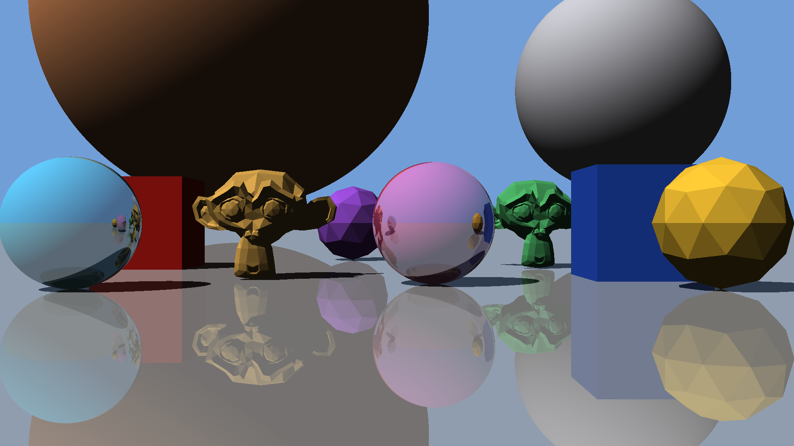

# From the client

| | |
|---|---|
| [`set-1/`](set-1/) | Our partner studio's first set: in words, as a scene file, its models, and our render of it |
| [`test-scene.png`](test-scene.png) | Our render of the evaluation's test scene |

## The test scene

At the evaluation, every group renders the same test scene on the farm. You'll get its file on the day, in the format of the RFC's final version. It's built from the same models and the same kinds of objects as set 1, only more of them.

