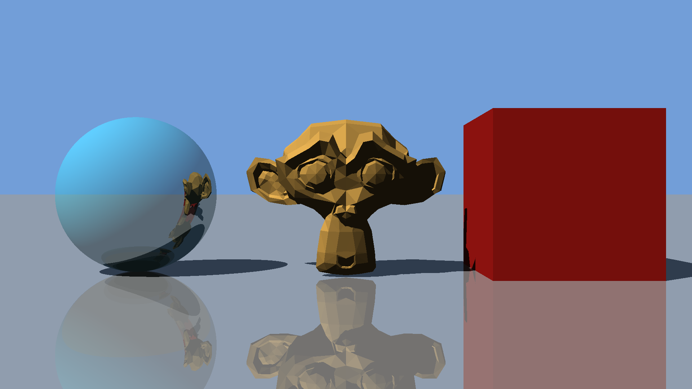

# Set 1: a monkey, a mirror and a cube in the sun

Our partner studio's first set. First in words, as they described it to us, then as a scene file.

## In words

Three objects of about the same height stand side by side on a grey floor:

- in the middle, the studio's mascot, a monkey's head, in gold, looking at the camera;
- on its left, a teal ball, polished like metal: the monkey, the floor and the sky show in it;
- on its right, a red cube.

The floor is polished too: everything shows in it, faintly.

The sun is high, behind the camera and to the left, so every object casts a shadow to the right and away from the camera. Where the sun doesn't reach, things are dark, but not black. Above the horizon, a clear, light blue sky.

The camera stands level with the middle of the three objects, 9 units in front of them, and looks straight at them. The picture is full HD: 1920 by 1080 pixels.

*Our render of the set.*

## As a scene file

[`set.json`](set.json) says the same, in numbers. Distances are in units: the ball is 2 units across.

| Field | What it is |
|---|---|
| `image` | The picture's `width` and `height`, in pixels |
| `camera` | `eye`: where the camera is. `screenCentre`: the centre of the screen it looks through. `screenWidth`: how wide that screen is |
| `reflections` | How many times a ray may bounce off a polished surface |
| `ambient` | How much of its colour a surface keeps where the sun doesn't reach it |
| `background` | The colour where there's nothing: the sky |
| `sun` | Its `direction`: which way the sunlight travels |
| `objects` | Everything in the set. `type`: `sphere`, `plane` or `mesh`. `name`: ours, so that we can talk about it |
| `position` | Where an object is: a sphere's centre, a point on a plane, or where a model's origin goes |
| `radius` | A sphere's radius |
| `normal` | Which way a plane faces |
| `obj` | A mesh's model, as an OBJ file |
| `material` | Its `colour`, red, green and blue, each from 0 to 1, and its `reflectivity`, from 0, not polished at all, to 1, a perfect mirror |

Vectors are written `{ "x": …, "y": …, "z": … }`, and colours `{ "r": …, "g": …, "b": … }`.

## The models

In [`models/`](models/), as the studio's modelling software exported them, with their `.mtl` files. Each one is centred on its own origin.

| File | What | Faces |
|---|---|---|
| `monkey.obj` | The mascot, facing the camera | 967 triangles |
| `cube.obj` | A cube, 2 units across | 6 squares |
| `sphere.obj` | A faceted ball, 2 units across | 80 triangles |

Set 1 uses the monkey and the cube.
